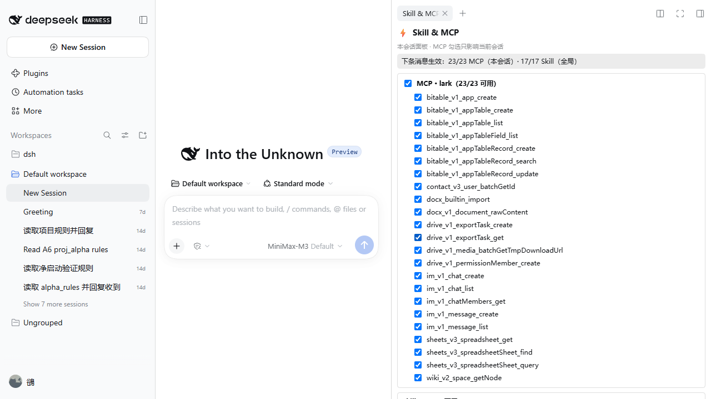
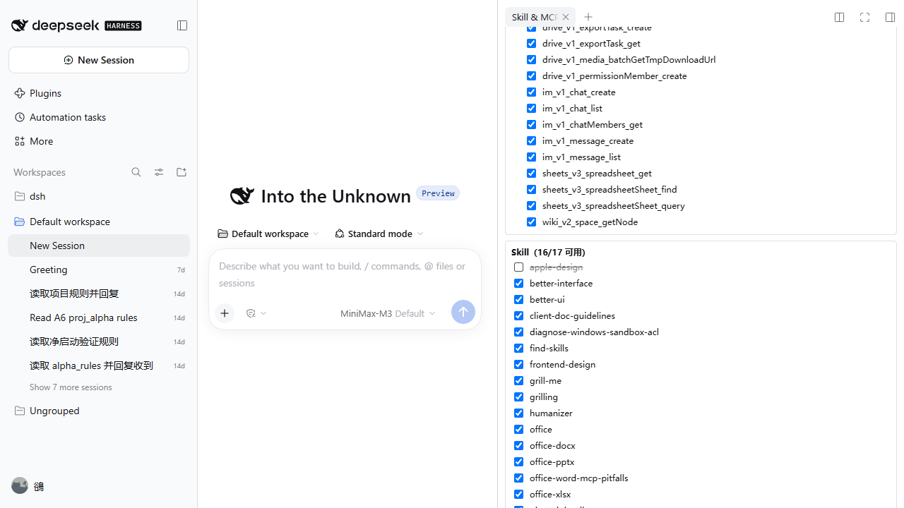
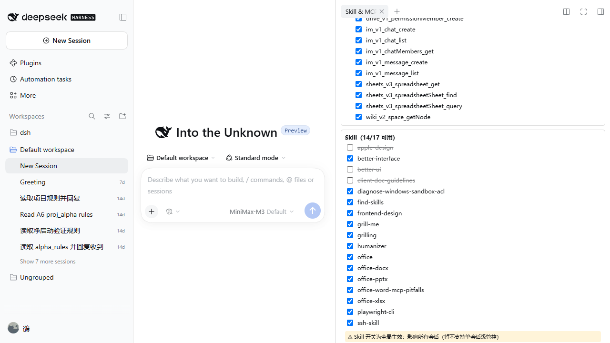

<div align="center">

# dsh-skillmcp-gate

**按会话与全局管控暴露给模型的 skill 与 MCP 工具。**

插件提供右侧栏面板：MCP 工具按 server 分组勾选，skill 各有独立开关。取消勾选一项，它就在下一条消息时从模型的工具与技能目录中移除。

<p align="center">
  <a href="LICENSE"></a>
  <a href="https://github.com/ciskonc/dsh-skillmcp-gate"></a>
  <a href="https://github.com/ciskonc/dsh-skillmcp-gate/issues"></a>
  <a href="https://github.com/ciskonc/dsh-skillmcp-gate/graphs/contributors"></a>
</p>

[English](README_EN.md) | 中文

</div>

---

## 简介

dsh-skillmcp-gate 是一个 DeepSeek Harness 插件，按会话或全局管控 skill 与 MCP 工具的暴露集。面板中的开关先积累为草稿，再一次性批量应用，一组变更一起生效而不是逐条生效。

默认状态下，每个已连接 MCP server 的全部工具与全部已安装 skill 都直接暴露给模型，会话中途没有任何手段裁剪这份清单。

接入之后，右侧栏面板成为默认入口。配置持久化在 `~/.dsh/storages/skillmcp-gate.json`；安装后需重启一次实例，此后的目录变更在下一条消息生效。

## 截图

右侧栏面板实际形态：MCP 工具按 server 分组，下方为 skill 开关。

<p align="center"></p>

## 安装

<details>
<summary>通过 dsh plugin 安装</summary>

```sh
dsh plugin --profile web add dsh-skillmcp-gate
```

安装后重启 DSH 实例：插件的 client 代码由 host 内存下发，重启后面板才出现。

</details>

<details>
<summary>从源码构建</summary>

```sh
git clone https://github.com/ciskonc/dsh-skillmcp-gate.git
```

插件需要四个 peer 依赖：`@deepseek-ai/cordis`（4.0.0-rc 及以后）、`@deepseek-ai/dsh-llm`、`@deepseek-ai/dsh-tools`（两者在 0.2.x prerelease 线）与 `@deepseek-ai/schemastery`（3.18.2 及以后）。构建就位后重启实例。

</details>

## 用法

<details>
<summary>会话面板</summary>

右侧栏面板是默认入口。MCP 工具按所属 server 分组、各有一个勾选框，skill 在下方各有独立开关。勾选变更先积累为草稿，再批量应用；被取消勾选的条目在下一条消息时离开模型目录。

草稿栏与变更计数：

<p align="center">
  
  
</p>

</details>

<details>
<summary>设置页</summary>

设置页承载全局默认、debug 开关与 banner 开关。默认值在这里，会话级变更在侧栏。

</details>

<details>
<summary>持久化与生效时机</summary>

MCP 工具管控是会话级：勾选集作为 `tools.restrict` 应用到会话，变更在下一条消息生效。skill 管控是全局的：插件过滤 `skills.snapshot`，这是架构限制，UI 以提示条说明。

配置持久化在 `~/.dsh/storages/skillmcp-gate.json`。安装后必须重启实例，插件才生效。

</details>

## 兼容性

| 插件版本 | 实测 DSH 版本 | 说明 |
|---|---|---|
| 0.5.4（2026-11-20） | 0.2.2-rc.5 | 当前版本，完整实测 |
| 0.5.x | DSH ≥ 0.2.x | 0.5.x 线在 DSH 0.2.x 及以上实测 |

## 已知限制

- skill 无法按会话管控；skill 暴露对整个实例全局生效。
- 内置工具不在管控范围；插件只管 MCP 工具。
- 从面板提交 skill 变更会覆盖全局 skill 配置。

## 许可证

许可信息以[仓库](https://github.com/ciskonc/dsh-skillmcp-gate)为准。
