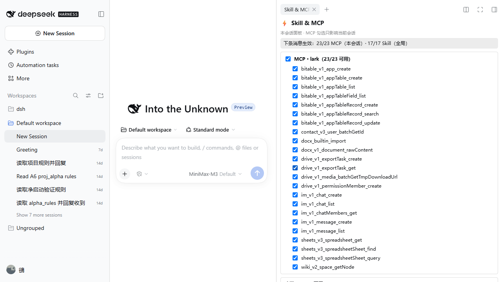
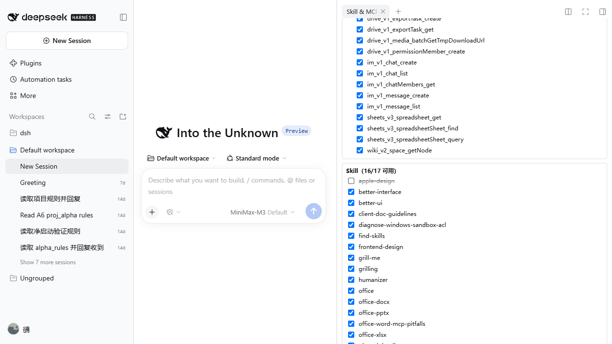
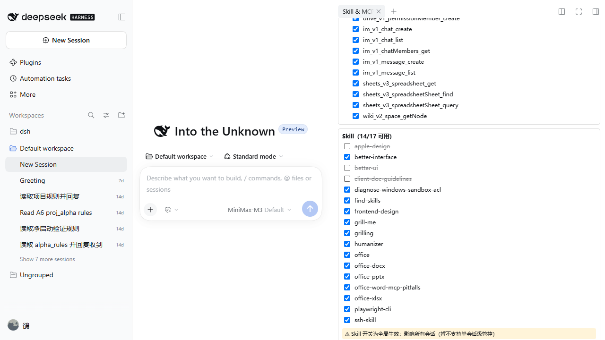

<div align="center">

# dsh-skillmcp-gate

**Per-session and global gating for the skills and MCP tools exposed to your model.**

The plugin ships a side panel where MCP tools are grouped by server and skills carry individual switches. Uncheck an entry and it leaves the model's tool and skill catalogs on the next message.

<p align="center">
  <a href="LICENSE"></a>
  <a href="https://github.com/ciskonc/dsh-skillmcp-gate"></a>
  <a href="https://github.com/ciskonc/dsh-skillmcp-gate/issues"></a>
  <a href="https://github.com/ciskonc/dsh-skillmcp-gate/graphs/contributors"></a>
</p>

English | [中文](README.md)

</div>

---

## Introduction

dsh-skillmcp-gate is a DeepSeek Harness plugin that manages the exposure set of skills and MCP tools, per session or globally. Toggles in the panel accumulate as drafts and are applied in one batch, so a set of changes lands together instead of entry by entry.

By default, every tool of every connected MCP server and every installed skill is exposed to the model, and there is no per-session handle to trim that set mid-conversation.

The side panel becomes the default entry point once the plugin is added. Configuration persists in `~/.dsh/storages/skillmcp-gate.json`; the instance needs one restart after install, and catalog changes after that take effect on the next message.

## Screenshot

The side panel in place: MCP tools grouped by server, skill switches below.

<p align="center"></p>

## Installation

<details>
<summary>Install through dsh plugin</summary>

```sh
dsh plugin --profile web add dsh-skillmcp-gate
```

Restart the DSH instance after installing: the plugin's client code is served from host memory, so the panel only appears after a restart.

</details>

<details>
<summary>Build from source</summary>

```sh
git clone https://github.com/ciskonc/dsh-skillmcp-gate.git
```

The plugin expects four peer dependencies: `@deepseek-ai/cordis` (4.0.0-rc and later), `@deepseek-ai/dsh-llm`, `@deepseek-ai/dsh-tools` (both on 0.2.x prerelease lines) and `@deepseek-ai/schemastery` (3.18.2 and later). Restart the instance once the build is in place.

</details>

## Usage

<details>
<summary>Session panel</summary>

The side panel is the default entry point. MCP tools appear grouped by their server with one checkbox each, and skills sit below with individual switches. Toggling entries accumulates a draft that is applied in one batch; unchecked entries leave the model's catalogs on the next message.

The draft bar with its change count:

<p align="center">
  
  
</p>

</details>

<details>
<summary>Settings page</summary>

The settings page carries the global defaults plus a debug switch and a banner switch. Defaults live here; per-session changes live in the side bar.

</details>

<details>
<summary>Persistence and when changes take effect</summary>

MCP tool gating is per session: the checked set is applied as `tools.restrict` on the session, so changes land on the next message. Skill gating is global: the plugin filters the `skills.snapshot`, which is an architecture limit the UI flags with a banner.

Configuration persists in `~/.dsh/storages/skillmcp-gate.json`. The instance must be restarted after install for the plugin to take effect.

</details>

## Compatibility

| Plugin version | DSH version tested | Notes |
|---|---|---|
| 0.5.4 (2026-11-20) | 0.2.2-rc.5 | Current release, fully tested |
| 0.5.x | DSH ≥ 0.2.x | The 0.5.x line is tested on DSH 0.2.x and later |

## Known limitations

- Skills cannot be gated per session; skill exposure is global to the instance.
- Built-in host tools are not gated; the plugin manages MCP tools only.
- Submitting skill changes from the panel overwrites the global skill configuration.

## License

Licensing information is maintained in the [repository](https://github.com/ciskonc/dsh-skillmcp-gate).
